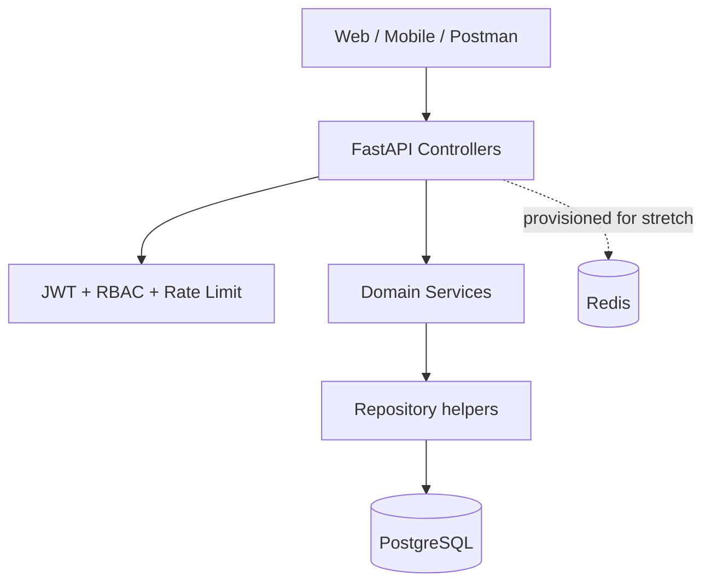

# Telecom Prepaid REST API

Internship project baseline for a fictional Ahmedabad MVNO. Python FastAPI + SQLAlchemy, PostgreSQL, JWT, RBAC, validation, central error handling, structured request logs, rate limiting, tests, Docker Compose, OpenAPI and k6 load-test scenario.

## Run
1. Copy `.env.example` to `.env`; replace `SECRET_KEY`.
2. `docker compose up --build`
3. Swagger UI: http://localhost:8000/docs | OpenAPI: http://localhost:8000/openapi.json

Demo-only credentials: `admin@demo.local / AdminPass123!`, `staff@demo.local / StaffPass123!`, `user@demo.local / UserPass123!`. Never deploy these.

Local dev: `pip install -r requirements.txt`; set `DATABASE_URL=sqlite:///./telecom.db`; `python -m app.seed`; `uvicorn app.main:app --reload`.

## Routes (25+)
Auth: register, token, me. Plans: list/search/filter/page, detail, create, update, deactivate. Circles: list/search/page, detail, create, update, delete. Subscribers: list/search/filter/page, detail, create, update, close. Recharges: list, create. Complaints: list, create, status update. Usage: list, create. Analytics summary. Health check. All routes are included in generated OpenAPI.

## Data design and messy-data rules
- Money uses integer paise; plan data quota and usage use MB.
- GB ingestion converts at 1 GB = 1024 MB; source unit remains recorded.
- Subscribers have explicit `active`, `suspended`, `ported_out`, `closed` lifecycle states. Seed corrects a stale ACTIVE subscriber marked `[PORTED]`; production should use porting-event data, not a name string.
- Complaints preserve app and call-centre records separately with source-specific external references. Cross-channel duplicate resolution needs a shared correlation ID or fuzzy matching workflow; blindly deleting records loses audit evidence.
- Recharge reference is unique to prevent duplicate recharge submissions.
- Circle and subscriber relationships use foreign keys.

## Architecture

Folders separate models, schemas, repositories, services and API routes (main controller module), plus core configuration.

## Tests
`pytest` or `coverage run -m pytest && coverage report`. The acceptance target is >=75%; this archive does not claim a measured coverage percentage. Run the report and add tests until it passes.

## Load test
`k6 run -e BASE_URL=http://localhost:8000 load/k6-plans.js`. The scenario targets 200 requests/sec for 60 seconds and thresholds p95 <300ms / errors <1%. This is a test definition, not evidence that the machine meets the target.

## Honest scope / production hardening
Redis is included in Compose but cache-aside is not wired into the plan endpoint. Add Redis caching with invalidation on plan writes before claiming the stretch requirement. Performance and coverage must be measured. Further production work: migrations, refresh token rotation/revocation, ownership-scoped end-user data access, TLS, secrets manager, audit logs, account lockout, correlation IDs and payment-provider integration. The current user role is allowed to invoke recharge creation but the API needs subscriber ownership verification before real-world deployment.
